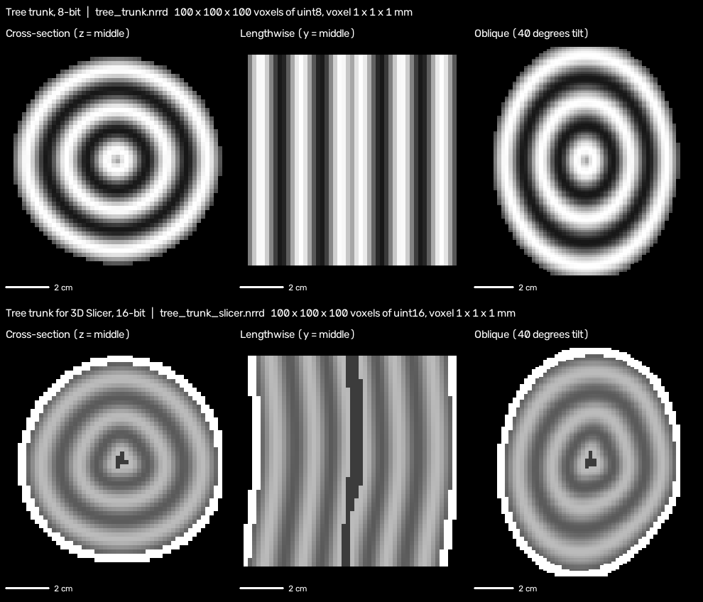
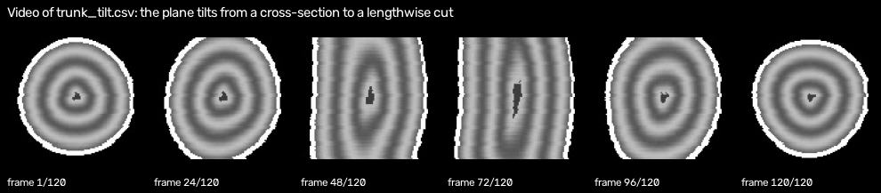

# Ex1: 3D Volume Plane Projection

## 1. Problem Definition
In this project, we receive a 3D matrix M with three axes (X, Y, Z) of size sx * sy * sz (where 1 <= sx, sy, sz < 2^10), representing a 3D medical scan. Each cell M[x][y][z] contains an unsigned integer value (8, 16, or 32-bit).

Along with the 3D matrix, we receive a 3D plane p defined either by 3 points forming an isosceles triangle (a, b, c) where dist(a,b) = dist(a,c), or by 4 points forming an isosceles trapezoid.

**The Goal:**
Scan the 3D matrix M along the given plane p and project the sampled values onto a 2D image matrix E. 
- Any sampled point along the plane that falls outside the boundaries of M is assigned a value of `0`.
- **Performance Requirement:** Given a 500^3 byte matrix, the projection algorithm must run at a minimum of **30 FPS**, aiming for **100+ FPS**.


## 2. Project Scope
### Inputs:
1. **`<file.nrrd>`:** A 3D volumetric data file containing the 3D matrix M (e.g., an MRI scan).
2. **`<file.csv>`:** A CSV file where each row contains 3 or 4 3D coordinates defining a slicing plane.

### Output:
3. **`<file.mp4>`:** A video file generated from the sequence of 2D projected images (one frame per plane row in the CSV file, in sequential order).

### Out of Scope:
- Interactive GUI or 3D viewer interface (the program runs via Command-Line Interface only).

## 3. How to Run
```bash
python Ex0.py file.nrrd file.csv file.mp4
```

Example, with the files of this repository:
```bash
pip install -r requirements.txt
python Ex0.py data-NRRD/tree_trunk_slicer.nrrd data-CSV/trunk_tilt.csv video/result.mp4
```

The `<file.csv>` has one plane per row, either 9 numbers (triangle a, b, c) or 12 numbers
(trapezoid a', b, a'', c). A header line and a first column with the number of points (3 or 4)
are also accepted, see `data-CSV/trunk_rotate.csv`.

## 4. Project Structure
| Path | Content |
|------|---------|
| `Ex0.py` | The demo "main" |
| `src/` | The code: volume loading, CSV reading, projection, normalization, framing, video writing |
| `tests/` | Unit tests (`pytest tests/`) |
| `data-NRRD/` | The NRRD volumes (see DATASET.md) |
| `data-CSV/` | The plane files |
| `scripts/` | Scripts that create the data, the benchmark and the images |
| `video/` | Result videos of the experiment |
| `images/` | Illustration images |
| `SRS.md`, `algorithm_design.md`, `DATASET.md`, `TESTING.md` | Requirements, algorithm, data set and test strategy |

## 5. Experiment and Results
The experiment runs the demo on a synthetic "tree trunk" volume (100x100x100, 16-bit),
`data-NRRD/tree_trunk_slicer.nrrd`. It has a 3D Slicer header (orientation, voxel size in mm), so it also
opens in 3D Slicer. The plane file `data-CSV/trunk_tilt.csv` has 120 trapezoids: the plane tilts from a
cross-section to a lengthwise cut.

```bash
python Ex0.py data-NRRD/tree_trunk_slicer.nrrd data-CSV/trunk_tilt.csv video/tree_trunk_slicer_tilt.mp4
```

Expected and observed results:
- A cross-section of the trunk shows concentric circles, a lengthwise cut shows stripes, an oblique cut shows ellipses.
  This is what the images and the video show.
- Parts of a plane outside the volume are black (0), and the video has one frame per CSV row (120).
- Speed: the vectorized projection reaches about **230 frames per second** on a 500x500x500 byte volume
  (`python -m scripts.benchmark`), above the required 30 and the 100 target.





The result video is `video/tree_trunk_slicer_tilt.mp4`. The other plane files in `data-CSV/` (`trunk_sweep.csv`,
`trunk_rotate.csv`) and the 8-bit trunk `data-NRRD/tree_trunk.nrrd` can be used the same way.
