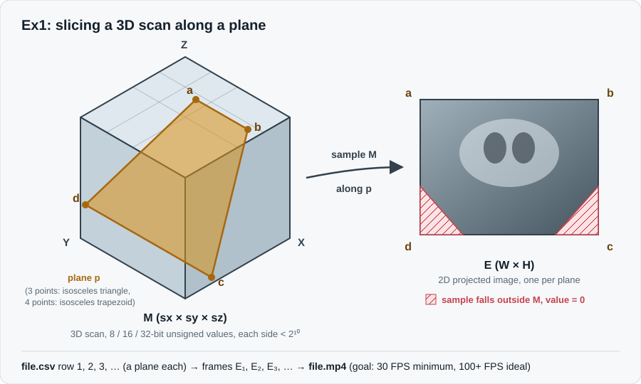

# Ex1: 3D Volume Plane Projection

## 1. Problem Definition
In this project, we receive a 3D matrix M with three axes (X, Y, Z) of size sx * sy * sz (where 1 <= sx, sy, sz < 2^10), representing a 3D medical scan. Each cell M[x][y][z] contains an unsigned integer value (8, 16, or 32-bit).

Along with the 3D matrix, we receive a 3D plane p defined either by 3 points forming an isosceles triangle (a, b, c) where dist(a,b) = dist(a,c), or by 4 points forming an isosceles trapezoid.

**The Goal:**
Scan the 3D matrix M along the given plane p and project the sampled values onto a 2D image matrix E. 
- Any sampled point along the plane that falls outside the boundaries of M is assigned a value of `0`.
- **Performance Requirement:** Given a 500^3 byte matrix, the projection algorithm must run at a minimum of **30 FPS**, aiming for **100+ FPS**.



## 2. Project Scope
### Inputs:
1. **`<file.nrrd>`:** A 3D volumetric data file containing the 3D matrix M (e.g., an MRI scan).
2. **`<file.csv>`:** A CSV file where each row contains 3 or 4 3D coordinates defining a slicing plane.

### Output:
3. **`<file.mp4>`:** A video file generated from the sequence of 2D projected images (one frame per plane row in the CSV file, in sequential order).

### Out of Scope:
- Interactive GUI or 3D viewer interface (the program runs via Command-Line Interface only).

## 3. How to Run
```bash
python Ex0.py file.nrrd file.csv file.mp4
